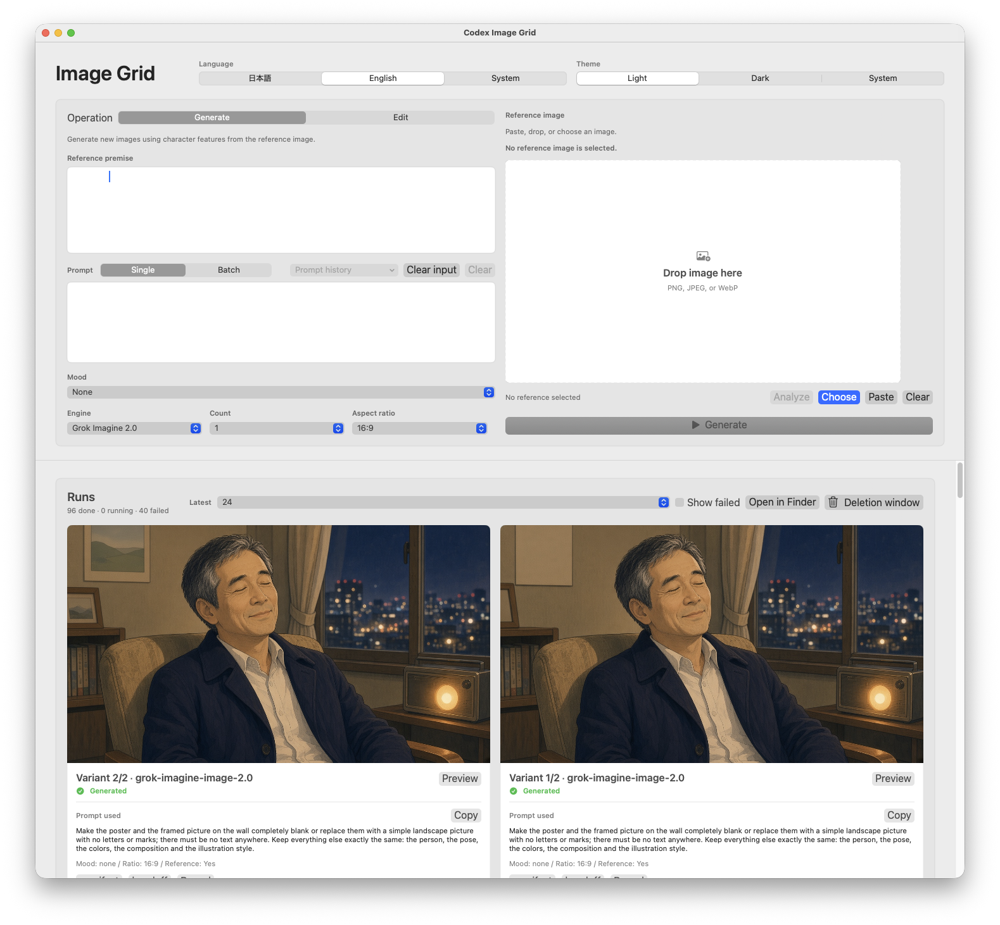
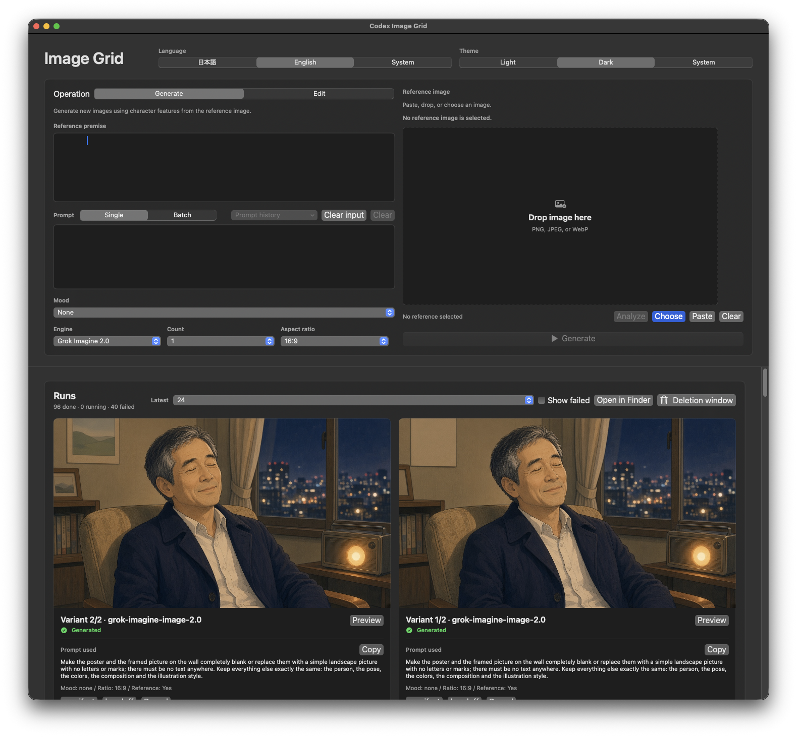
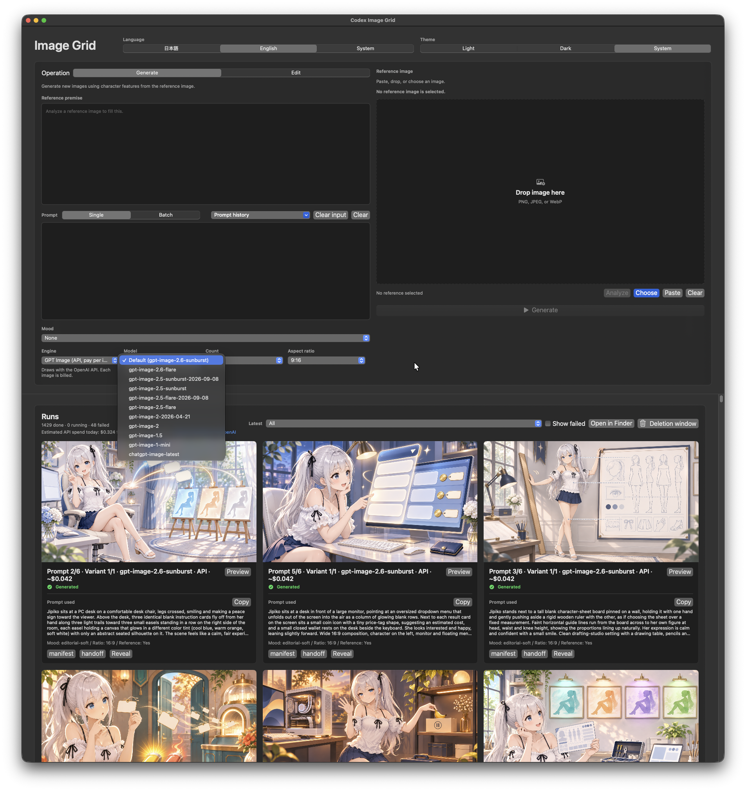

# Codex Image Grid

A native macOS image-generation workspace for Codex and Claude Code, built with Rust and
SwiftUI. It provides Prompt Batch generation and editing, reference-image analysis,
Japanese/English UI, light/dark themes, run history, and artifact handoff
through the `codex_image_grid/generate_image_grid` MCP tool. Images are drawn
with Grok Imagine (2.0 or the older model) through the local Grok CLI, with
Codex image generation, with the OpenAI Image API, or as SVG with `codex-svg`.
A call names its engine and aspect ratio; Image Grid chooses neither and
answers a call that leaves one open with the question.

Codex・Claude Code向けのmacOSネイティブ画像生成ワークスペースです。RustとSwiftUIで
実装され、Prompt Batchでの生成・編集、参照画像解析、日英UI、ライト/ダークテーマ、
生成履歴、成果物の受け渡しに対応しています。画像はローカルのGrok CLIを通した
Grok Imagine（2.0・旧モデル）、Codexの画像生成、OpenAIのImage API、`codex-svg`でのSVGで
描けます。エンジンと縦横比は呼び出し側が指定します。Image Gridはどちらも自分では選ばず、
指定のない呼び出しには何も描かずに聞き返します。

[English](#english) · [日本語](#日本語)

## UI preview / UIプレビュー

<picture>
  <source media="(prefers-color-scheme: dark)" srcset="./docs/assets/codex-image-grid-dark.png">
  <source media="(prefers-color-scheme: light)" srcset="./docs/assets/codex-image-grid-light.png">
  
</picture>

<details>
<summary>Show both themes / 両テーマを表示</summary>

| Light / ライト | Dark / ダーク |
| --- | --- |
|  |  |

</details>

## English

### Requirements

- macOS 14 or later
- Apple Swift 6.3 toolchain
- Rust 1.99.1 (selected automatically by `rust-toolchain.toml`)
- The Grok CLI (`grok`), installed and signed in, for the `grok-imagine-2`
  and `grok-imagine` engines
- Codex CLI installed and signed in, for the `app-server-image` and `codex-svg`
  engines, the `gpt-image` engine's plan lookup, and reference-image analysis
- An OpenAI API key with credit, for the `openai-image-api` engine (and for
  `gpt-image` when there is no paid ChatGPT plan)
- `jq`, `rg`, `curl`, Xcode command-line tools, and internet access for the
  first dependency build

The `app-server-image` engine uses `codex app-server`, so the active Codex
account must have access to image generation to use it.

### Automatic setup when opened in Codex

Clone this repository and open the clone as a Codex workspace. On the first
setup, build, test, run, or source task, the repository-scoped `AGENTS.md`
instructs Codex to run:

```bash
scripts/bootstrap-codex.sh
```

The idempotent bootstrap:

1. checks the macOS toolchain;
2. builds the locked Rust workspace and release SwiftUI app;
3. installs the signed app at
   `~/Applications/Codex Image Grid Native.app`;
4. registers this clone as the `codex-image-grid-native` local marketplace;
5. installs the `codex-image-grid` plugin; and
6. records a source fingerprint under the ignored `.run/` directory so an
   unchanged clone is not rebuilt.

Passive cloning alone does not execute repository code. Codex performs the
bootstrap when it starts an applicable task in the imported workspace. The
script stops without replacing anything if another source already owns the
same plugin or marketplace identity.

Preview the setup without changing the machine:

```bash
scripts/bootstrap-codex.sh --dry-run
```

Rebuild and refresh a plugin installed by this repository's marketplace after
an intentional source change:

```bash
scripts/bootstrap-codex.sh --force
```

Start a new Codex task after first-time plugin installation so the newly
installed MCP route is discovered.

### Claude Code plugin

The same `plugin/codex-image-grid/` package installs in Claude Code from this
repository's marketplace (`.claude-plugin/marketplace.json`). The plugin's MCP
server runs the binary inside `~/Applications/Codex Image Grid Native.app`, so
build and install the app first from a clone:

```bash
scripts/install-native-app.sh --execute
```

Then add the marketplace and install the plugin:

```bash
claude plugin marketplace add mlabo-org/codex-image-grid-native
```

```bash
claude plugin install codex-image-grid@codex-image-grid-native
```

To use your local clone instead of GitHub, run `claude plugin marketplace add .`
from the repository root. Start a new Claude Code session after installing.
A local-clone install loads the plugin in place, so plugin edits take effect at
the next session start or `/reload-plugins`. For a GitHub install, pick up a
newer plugin version with
`claude plugin marketplace update codex-image-grid-native` and then
`claude plugin update codex-image-grid@codex-image-grid-native`. When native
source changes, rebuild and reinstall the app with
`scripts/install-native-app.sh --execute`. Do not run
`scripts/bootstrap-codex.sh` for Claude Code; it registers the Codex
marketplace.

### Quick Start and MCP usage

#### Generate your first image

After setup, start a new Codex task or Claude Code session and ask:

> Use `codex_image_grid/generate_image_grid` with `waitMs: 120000` to generate
> one 16:9 `clean-thumbnail` image: "A polished product hero for a native
> macOS image-generation app, graphite background, blue accent, no text."

The host agent (Codex or Claude Code) turns the natural-language request into an MCP call, so you do not need
to write JSON yourself. The native SwiftUI app opens or becomes active
automatically. When generation completes, the host agent receives display-safe image
URLs, absolute output paths, `codexMarkdown` image links, and artifact handoff information.

To submit multiple prompts and image jobs together, ask for a Prompt Batch:

> Use `codex_image_grid/generate_image_grid` to create one Prompt Batch. Make
> one 16:9 image for each prompt: (1) a clean product hero for the app; (2) an
> editorial scene showing prompts becoming an image grid.

Multiple prompts are submitted in one `prompts` array. `count` sets the number
of variants for every prompt, so two prompts with two variants create four
image jobs in the same run.

#### Native UI or agent/MCP?

| Route | Best for |
| --- | --- |
| Native SwiftUI app | Editing Prompt Batches interactively, choosing the engine (GPT Image through App Server, the API, or picked automatically; Codex SVG; Grok Imagine 2.0; or the older Grok Imagine model) and, for the API, its model, choosing a reference image with the macOS file picker, and watching progress or run history. |
| Codex or Claude Code/MCP | Generating from a Codex task or Claude Code session, passing project-specific prompts or local reference files, and handing absolute artifact paths to another workflow. |

Calling the MCP tool also opens the native app, so both routes use the same
local runtime and artifact history.

#### Representative MCP input and output

The following is an illustrative MCP argument object, not a shell command. It
sends two prompts with two variants each as one batch of four image jobs:

```json
{
  "prompts": [
    "A clean product hero for a native macOS image-generation workspace, graphite background, electric-blue accent, no text",
    "An editorial workflow scene showing prompt batches becoming a polished image grid, no text"
  ],
  "count": 2,
  "mood": "clean-thumbnail",
  "engine": "grok-imagine-2",
  "aspectRatio": "16:9",
  "referencePremise": "Preserve the mascot's round glasses and blue scarf.",
  "referenceImagePath": "/Users/you/Pictures/mascot.png",
  "waitMs": 120000
}
```

For generation, `prompts`, `engine`, and `aspectRatio` are required. A batch may contain up to 12 prompts and 6
variants per prompt, with at most 24 image jobs in total
(`prompts.length * count`). `referenceImagePath`, when supplied, must be an
absolute path to a local PNG, JPEG, or WebP file no larger than 100 MiB. Use
`engine: "grok-imagine-2"` or `"grok-imagine"` for Grok Imagine (see below),
`engine: "app-server-image"` for Codex image generation,
`engine: "openai-image-api"` or `"gpt-image"` for the GPT Image engines
described below, or `engine: "codex-svg"` for SVG output. `waitMs` may be from 0 through
120,000.

Image Grid does not choose the engine or the aspect ratio. A call that leaves
`engine` open, or a generation that leaves `aspectRatio` open, draws nothing
and gets a message back (`EngineRequired` or `AspectRatioRequired` over HTTP)
that lists the values and tells the caller to use what the user or the calling
workflow decided, and to ask the user when neither has. The MCP tool answers
this before it launches the app. The app's own engine picker and aspect-ratio
control apply only to runs started in the app; nothing chosen there reaches
another caller's request. Callers such as RelayPress and CodexVideo set both
values themselves and call again when they are asked. An edit keeps its
source's ratio and needs no `aspectRatio`.

`mood` adds a style line to the prompt (`warm-mascot` by default).
`mood: "none"` adds no style line, so the prompt alone sets the look.

`operation` defaults to `generate`, preserving existing character-reference
workflows such as creating different article illustrations featuring one mascot.
For partial changes to an existing image, use `operation: "edit"` and supply
the source as `referenceImagePath` with `engine: "grok-imagine-2"`,
`"grok-imagine"`, `"app-server-image"`, `"gpt-image"`, or `"openai-image-api"`:

```json
{
  "operation": "edit",
  "prompts": ["Replace the hamburger with a strawberry crepe. Preserve everything else."],
  "engine": "grok-imagine-2",
  "referenceImagePath": "/Users/you/Pictures/park.png",
  "waitMs": 120000
}
```

Editing preserves source identity, composition, style, and aspect ratio unless
the prompt requests a change. `mood`, `aspectRatio`, and `referencePremise`
are generation settings and are ignored for editing. Each batch edit starts
from the same supplied source; for a sequential edit, pass the preceding output
as the next source. The native app offers the same Generate/Edit choice.
Results and saved runs include `operation`; older runs default to `generate`.

#### GPT Image engines

GPT Image has two routes and one engine that picks between them.

- `app-server-image` draws through the Codex App Server on the ChatGPT
  subscription.
- `openai-image-api` calls the OpenAI Image API directly (`quality: "medium"`)
  and is billed per image to an API key. It draws with `gpt-image-2.6-sunburst`
  unless the request names another model in `model` (see below). Save the key in
  the app under Settings › OpenAI API. It is stored in the macOS keychain,
  handed only to the app's own server (on its standard input at launch and
  over loopback when it changes, never in its arguments or environment), held
  there in memory, and never written to a
  manifest, handoff, log, or response. A run without a key is rejected with
  `OpenAiApiKeyMissing` before anything is created.
- `gpt-image` is the app's "GPT Image (auto)" choice. When a run is admitted it
  asks the Codex App Server for the signed-in account: a paid ChatGPT plan
  draws through `app-server-image`; a free plan, an API-key login, or no login
  draws through `openai-image-api`. When Codex cannot report the plan, the run
  is rejected with `GptImageRouteUnknown` instead of guessing. The run's
  `engine` is the route that was picked, and its manifest keeps
  `requestedEngine: "gpt-image"`. `GET /api/gpt-image-route` reports the route
  a run would take now.

The billed API route draws in two cases only: a request names
`openai-image-api`, or the user picked "GPT Image (auto)" in the app (the app
marks its own requests with `engineChosenInApp`). For every other caller,
`gpt-image` and `app-server-image` are subscription engines: when Codex has no
paid ChatGPT plan, the run is rejected with `OpenAiApiNeedsApproval` and
nothing is drawn. The message tells the caller to ask the user whether to draw
with the API and, only on a yes, to call again with `openai-image-api`. An
`app-server-image` failure, including a rate limit, never moves a job to the
API route either; its message names the API as an option the user has to agree
to.

The refusal carries a machine-readable `fallback` beside `code`, for example
`{"engine": "openai-image-api", "reason": "no_paid_chatgpt_plan",
"billedPerImage": true, "apiKeyConfigured": true, "defaultModel":
"gpt-image-2.6-sunburst"}`. The MCP tool passes the code and the fallback to
the calling agent, which asks the user and, on a yes, calls again with the
fallback engine; nothing depends on the app being open. A Grok job that fails
because the CLI reports a lost sign-in, an ended plan, or a used-up allowance
ends with the same code (see the Grok section). In the app, a run on
"GPT Image (App Server)" first reads `GET /api/gpt-image-route`; when the
subscription cannot draw, and when a Grok job of a run started in the app ends
with that code, the app asks in a dialog whether to draw the same run with the
OpenAI API, and draws it only on a yes.

**Model.** An `openai-image-api` run may name the OpenAI image model in
`model`; other engines refuse the field (`model_not_supported_for_engine`)
instead of dropping it. Any ID of letters, digits, dots, dashes, and
underscores is passed to the API unchanged, so a later GPT Image version works
as soon as OpenAI offers it. GPT Image 2.5 and 2.6 have no bare IDs, only
variants: `gpt-image-2.6-sunburst`, `gpt-image-2.6-flare`,
`gpt-image-2.5-sunburst`, `gpt-image-2.5-flare` (plus dated snapshots);
`gpt-image-2` has none. An ID the API does not know fails with
`OpenAiImageModelUnavailable`, which costs nothing. Older models such as
`gpt-image-1.5` may refuse the custom sizes below.
`GET /api/openai-image-models` lists the `gpt-image` IDs the saved key can use
(from OpenAI's `GET /v1/models`) with the default model; a key restricted from
listing models (HTTP 403) gets the IDs documented on 2026-11-24 with
`"listed": false`. Give the key the "List models: Read" permission for the live
list. The app's model picker shows this list and also takes a typed ID.



**Spend.** Each API job records the token usage the response reported as
`apiUsage` (`inputTokens`, `outputTokens`, the text/image split of the input,
and `estimatedUsd`) in its result and manifest. The estimate uses the published
standard rates for `gpt-image-2`, 2.5, and 2.6 ($5 text input, $8 image input,
$30 image output per million tokens); other models get no estimate. The app
shows it on each card and today's total above the results. OpenAI offers no
balance endpoint to a project API key, so the app links to OpenAI's usage page
for the balance.

The API route sends the same prompt as the App Server route without the lines
that tell a Codex agent to call its image tool. Sizes are 1536×864 (16:9),
1408×1056 (4:3), 1024×1024 (1:1), 1056×1408 (3:4), and 864×1536 (9:16); an
edit keeps the source's own size. A job with an image, as an edit source or a
character reference, goes to the edits endpoint with the image inline, which
the API limits to about 15 MB. A rate limit or server error is retried once;
a moderation block (`ImageModerationBlocked`), a rejected key
(`OpenAiApiKeyRejected`), and exhausted credit (`OpenAiCreditExhausted`) are
not.

#### Grok Imagine engines

`engine: "grok-imagine-2"` and `engine: "grok-imagine"` draw through the local
Grok CLI's Imagine tools. When an `app-server-image` job fails on a rate limit,
its error message says so and names the Grok engines, and the billed
`openai-image-api` engine if the user agrees to its charge, as ways to rerun
the prompts; the engine is never switched automatically.

The Grok CLI cannot report its plan, so a lost sign-in, an ended plan, or a
used-up Imagine allowance (free plans have one) shows only when a job fails: a
CLI run that exits with an error whose output says so (not logged in,
unauthorized, 401/402/403, subscription, upgrade, usage limit, quota) ends
with `OpenAiApiNeedsApproval` instead of `ImageOutputMissing`, so the caller
offers the OpenAI API as for the App Server route. The check reads the CLI's
wording, which has not yet been seen for a real lapse.

- `grok-imagine-2` asks the CLI for Grok Imagine 2.0 (`grok-imagine-image-2.0`)
  by setting `GROK_IMAGE_GEN_MODEL_OVERRIDE` and `GROK_IMAGE_EDIT_MODEL_OVERRIDE`.
  Its style matches the web version's Imagine 2.0. Output stays 1024×1024 for
  1:1.
- `grok-imagine` uses the CLI's own default model
  (`grok-imagine-image-quality` in Grok CLI 1.0.62), which draws in a flatter,
  bold-line cel style.

- The CLI is looked up in `IMAGE_GRID_GROK_BIN`, `~/.local/bin/grok`,
  `~/.grok/bin/grok`, and then `PATH`. The job fails with `GrokCliUnavailable`
  when none is found.
- Output is JPEG (`variant-01.jpg`), with the same WebP copy as other engines.
- Without a reference image Grok uses `image_gen`; with one it uses
  `image_edit`. `aspectRatio`, `mood`, and `referencePremise` are passed to
  Grok for generation. The CLI's `image_edit` ignores the aspect ratio when it
  gets one image, so generation with a reference lists that image twice; an
  edit sends its source once and keeps the source's ratio.
- For generation with a reference, the reference supplies only the character's
  identity (face, hair, makeup, distinguishing marks) and outfit; Grok is asked
  to draw a new pose, camera angle, and composition. In practice, a prompt whose
  pose matches the reference pose can still return the reference figure with
  only the background redrawn, so describe a clearly different pose to change
  the angle. Check hands and small facial marks on Grok output.
- For `operation: "edit"`, Grok applies only the requested change and is asked
  to keep everything else.
- Up to four Grok jobs (both engines together) run at the same time. If Grok replies with text instead
  of calling the Imagine tool, the job is retried once in a fresh session.

A completed one-image call returns structured fields such as:

```json
{
  "runId": "<runId>",
  "status": "done",
  "completed": true,
  "outputPaths": [
    "/Users/you/Library/Application Support/codex-image-grid/generated/<runId>/variant-01.png"
  ],
  "webpPaths": [
    "/Users/you/Library/Application Support/codex-image-grid/generated/<runId>/variant-01.webp"
  ],
  "imageUrls": [
    "http://127.0.0.1:4322/generated/<runId>/variant-01.png"
  ],
  "manifestPath": "/Users/you/Library/Application Support/codex-image-grid/generated/<runId>/manifest.json",
  "handoffPath": "/Users/you/Library/Application Support/codex-image-grid/generated/<runId>/handoff.md",
  "codexMarkdown": ""
}
```

Each run is saved under
`~/Library/Application Support/codex-image-grid/generated/<runId>/`, including
the generated files, `manifest.json`, `handoff.md`, and a staged reference
image when one was supplied. If generation is still running when `waitMs`
expires, use the returned `statusUrl` or `handoffPath` to follow the run.

Every PNG or JPEG output also gets a lossy WebP copy (quality 80) beside it
with the same name, for example `variant-01.webp`, for uploading to a web site.
The PNG or JPEG stays the original: the app shows it, and `outputPaths` and
`imageUrls` point to it. The copies are listed in `webpPaths`, in each output's
`webpPath`, and in `handoff.md`. SVG output gets no copy. If a copy cannot be
written, the original still completes and the failure appears in that output's
`diagnosticLog`.

### Build and install manually

Run the complete provider-free acceptance command:

```bash
scripts/check.sh
```

Build the components directly:

```bash
CARGO_TARGET_DIR=/path/to/cargo-target cargo build --workspace --locked
swift build --scratch-path /path/to/swift-scratch --package-path macos
```

`scripts/check.sh`, `scripts/smoke-first-slice.sh`, and
`scripts/install-native-app.sh` place Cargo and Swift intermediate files in a
temporary directory outside the repository by default. Set
`CARGO_TARGET_DIR` to reuse an existing Cargo target directory; that directory
is preserved and is never cleaned by the scripts. To share one task-scoped
temporary build root across commands, set `CODEX_IMAGE_GRID_BUILD_ROOT` to an
existing directory and let the scripts derive the Cargo and Swift paths from
it.

Inspect or execute the native app installer:

```bash
scripts/install-native-app.sh --dry-run
scripts/install-native-app.sh --execute
```

Register the plugin manually from the repository root:

```bash
codex plugin marketplace add .
codex plugin add codex-image-grid@codex-image-grid-native
```

### Repository layout

- `crates/image-grid-core/` — validation, job state, retry policy, and artifact
  contracts.
- `crates/image-grid-server/` — loopback-only HTTP/SSE runtime and Codex App
  Server bridge.
- `crates/image-grid-mcp/` — stdio MCP server for
  `generate_image_grid`.
- `macos/` — native SwiftUI application.
- `plugin/codex-image-grid/` — installable plugin package for Codex and Claude Code.
- `.agents/plugins/marketplace.json` — local marketplace metadata for Codex.

Runtime files and generated images are stored outside the repository at
`~/Library/Application Support/codex-image-grid`. The local HTTP runtime binds
only to loopback and rejects non-loopback browser origins.

### License

MIT. See [LICENSE](LICENSE).

## 日本語

### 必要環境

- macOS 14以降
- Apple Swift 6.3ツールチェーン
- Rust 1.99.1（`rust-toolchain.toml`で自動選択）
- インストール・ログイン済みのGrok CLI（`grok`）：`grok-imagine-2`エンジン（アプリで一度も
  選んでいないときに使うエンジン）と`grok-imagine`エンジンで使います
- インストール・サインイン済みのCodex CLI：`app-server-image`・`codex-svg`エンジン、
  `gpt-image`エンジンのプラン確認、参照画像解析で使います
- 残高のあるOpenAIのAPIキー：`openai-image-api`エンジンで使います（ChatGPTの有料プランが
  ないときの`gpt-image`でも使います）
- `jq`、`rg`、`curl`、Xcode Command Line Tools
- 初回の依存関係取得に使うインターネット接続

`app-server-image`エンジンは`codex app-server`を使用します。このエンジンを使うには、
利用中のCodexアカウントで画像生成が使える必要があります。

### Codexに取り込んだときの自動セットアップ

このリポジトリをcloneし、そのcloneをCodexのワークスペースとして開いてください。
初回のセットアップ・ビルド・テスト・実行・ソース変更タスクで、リポジトリ内の
`AGENTS.md`に従い、Codexが次を実行します。

```bash
scripts/bootstrap-codex.sh
```

このスクリプトは一度の実行で次を行います。

1. macOSのビルド環境を確認
2. lock済みRustワークスペースとSwiftUIリリースアプリをビルド
3. `~/Applications/Codex Image Grid Native.app`へ署名・配置
4. このcloneを`codex-image-grid-native`ローカルマーケットプレイスとして登録
5. `codex-image-grid`プラグインをインストール
6. 無視対象の`.run/`へソース指紋を保存し、変更がなければ次回ビルドを省略

cloneしただけではリポジトリ内のコードは実行されません。Codexが取り込んだ
ワークスペースで対象タスクを開始した時点でセットアップされます。同名の
プラグインまたはマーケットプレイスを別ソースが所有している場合は、上書きせず
停止します。

マシンを変更せず内容だけ確認する場合:

```bash
scripts/bootstrap-codex.sh --dry-run
```

意図的なソース変更後、このリポジトリのマーケットプレイスから入れたプラグインを
再ビルド・再反映する場合:

```bash
scripts/bootstrap-codex.sh --force
```

初回プラグインインストール後は、新しいCodexタスクを開始すると追加されたMCPが
検出されます。

### Claude Codeプラグイン

同じ`plugin/codex-image-grid/`を、Claude Codeではこのリポジトリのマーケットプレイス
（`.claude-plugin/marketplace.json`）からインストールします。プラグインのMCPサーバーは
`~/Applications/Codex Image Grid Native.app`内のバイナリを起動するため、先にcloneから
アプリをビルド・配置してください。

```bash
scripts/install-native-app.sh --execute
```

次にマーケットプレイスを追加し、プラグインをインストールします。

```bash
claude plugin marketplace add mlabo-org/codex-image-grid-native
```

```bash
claude plugin install codex-image-grid@codex-image-grid-native
```

GitHubではなく手元のcloneを使う場合は、リポジトリのルートで
`claude plugin marketplace add .`を実行します。インストール後は新しいClaude Code
セッションを開始してください。手元のcloneから入れた場合はプラグインをその場で
読み込むので、プラグインの変更は次のセッション開始か`/reload-plugins`で効きます。
GitHubから入れた場合は、新しい版を取り込むときに
`claude plugin marketplace update codex-image-grid-native`のあとに
`claude plugin update codex-image-grid@codex-image-grid-native`を実行します。
ネイティブのソースを変えたときは`scripts/install-native-app.sh --execute`で
再ビルド・再配置します。Claude Codeでは`scripts/bootstrap-codex.sh`を実行しないで
ください（Codexのマーケットプレイスを登録するスクリプトです）。

### Quick StartとMCP利用

#### 最初の1枚を生成

セットアップ完了後、新しいCodexタスクまたはClaude Codeセッションで次のように依頼します。

> `codex_image_grid/generate_image_grid`を使い、「macOSネイティブ画像生成アプリを
> 紹介する、グラファイト背景と青いアクセントの洗練された製品ビジュアル、
> 文字なし」を、`clean-thumbnail`、16:9で1枚生成してください。完了を最大120秒
> 待ってください。

ホストエージェント（CodexまたはClaude Code）が自然言語の依頼からMCPを呼び出すため、JSONを手書きする必要はありません。
ネイティブSwiftUIアプリが自動的に開くか、前面へ移動します。生成完了後は、
表示用画像URL、絶対パス、`codexMarkdown`の画像リンク、成果物の受け渡し情報がホストエージェントへ返ります。

複数のプロンプトや画像ジョブをまとめて依頼する場合は、Prompt Batchとして依頼します。

> `codex_image_grid/generate_image_grid`を使い、1つのPrompt Batchを作成してください。
> 次の各プロンプトから16:9画像を1枚ずつ生成してください。(1) アプリのクリーンな
> 製品ビジュアル、(2) プロンプトが画像グリッドになる編集風の作業シーン。

複数のプロンプトは1つの`prompts`配列で送信されます。`count`は各プロンプトの
バリエーション数を指定するため、2プロンプトで各2枚を指定すると、同じ実行内で
4つの画像ジョブが作成されます。

#### ネイティブUIとエージェント/MCPの使い分け

| 利用方法 | 適している場面 |
| --- | --- |
| ネイティブSwiftUIアプリ | Prompt Batchを画面で調整する、エンジン（GPT ImageのApp Server・API・自動、Codex SVG・Grok Imagine 2.0・Grok Imagine旧モデル）とAPIのモデルを選ぶ、macOSのファイル選択から参照画像を指定する、進行状況や生成履歴を確認する場合 |
| Codex・Claude Code/MCP | CodexタスクやClaude Codeセッションの文脈から生成する、プロジェクト固有のプロンプトやローカル参照ファイルを渡す、絶対パス付きの成果物を別工程へ引き渡す場合 |

MCPから呼び出した場合もネイティブアプリが開き、両方の経路が同じローカルランタイムと
成果物履歴を使用します。

#### MCPの代表的な入力と出力

次はMCPへ渡される引数の例であり、シェルコマンドではありません。2つのプロンプトと
各2枚のバリエーションを1つのバッチとして送信し、4つの画像ジョブを作成します。

```json
{
  "prompts": [
    "A clean product hero for a native macOS image-generation workspace, graphite background, electric-blue accent, no text",
    "An editorial workflow scene showing prompt batches becoming a polished image grid, no text"
  ],
  "count": 2,
  "mood": "clean-thumbnail",
  "engine": "grok-imagine-2",
  "aspectRatio": "16:9",
  "referencePremise": "丸い眼鏡と青いスカーフというマスコットの特徴を維持する。",
  "referenceImagePath": "/Users/you/Pictures/mascot.png",
  "waitMs": 120000
}
```

新規生成の必須項目は`prompts`・`engine`・`aspectRatio`です。1つのバッチには最大12プロンプト、各プロンプトには最大
6バリエーションを指定でき、合計24画像ジョブまでです
(`prompts.length * count`)。`referenceImagePath`には、100 MiB以下のローカルPNG・JPEG・
WebPファイルの絶対パスを指定します。Grok Imagineで描く場合は
`engine: "grok-imagine-2"`か`"grok-imagine"`（後述）、Codexの画像生成で描く場合は
`engine: "app-server-image"`、後述のGPT Imageエンジンで描く場合は
`engine: "openai-image-api"`か`"gpt-image"`、SVGが必要な場合は`engine: "codex-svg"`を使用します。
`waitMs`には0から120,000までを指定できます。

Image Gridは、エンジンも縦横比も自分では選びません。`engine`のない呼び出しと、
`aspectRatio`のない新規生成は、何も描かずにメッセージを返します（HTTPでは`EngineRequired`
または`AspectRatioRequired`）。メッセージには選べる値の一覧と、「ユーザーか呼び出し元の
ワークフローが決めた値を入れ、どちらも決めていなければユーザーに聞く」という指示が入ります。
MCPツールは、アプリを起動する前にこの返答をします。アプリのエンジン選択と縦横比の設定は、
アプリから始めた実行にだけ効き、ほかの呼び出しには一切影響しません。RelayPressやCodexVideo
などの呼び出し側は、両方の値を自分で指定し、聞き返されたら値を入れて呼び直します。
編集は元画像の縦横比を保つので、`aspectRatio`は要りません。

`mood`は、プロンプトに雰囲気の指定を1行足します（既定は`warm-mascot`）。
`mood: "none"`では何も足さず、プロンプトだけで画風が決まります。

`operation`を省略すると従来どおり`generate`になります。じぴこのベース画像から
特徴を引き継いで各H2の新しい場面を作る、といった参照生成はそのまま使えます。
元画像の一部を変更する場合は`operation: "edit"`にし、`referenceImagePath`に元画像を指定します。
編集のエンジンは`grok-imagine-2`・`grok-imagine`・`app-server-image`・`gpt-image`・
`openai-image-api`のいずれかです。

```json
{
  "operation": "edit",
  "prompts": ["ハンバーガーだけをいちごクレープに変更して。他の部分は維持して。"],
  "engine": "grok-imagine-2",
  "referenceImagePath": "/Users/you/Pictures/park.png",
  "waitMs": 120000
}
```

編集では、指示された変更を除き人物・構図・画風・縦横比を維持します。
生成用の`mood`・`aspectRatio`・`referencePremise`は編集時には適用しません。
バッチの各編集は同じ元画像から独立して実行します。続けて編集する場合は、前の出力を
次の元画像として渡してください。ネイティブ画面でも「生成／編集」を選択できます。
結果と保存済み実行には`operation`が記録され、古い履歴は`generate`として読み込まれます。

#### GPT Imageエンジン

GPT Imageには2つの経路と、そのどちらかを選ぶエンジンがあります。

- `app-server-image`は、ChatGPTのサブスクリプションでCodex App Server経由で描きます。
- `openai-image-api`は、OpenAIのImage APIを直接呼びます（`quality: "medium"`）。
  リクエストが`model`で別のモデルを指定しない限り、`gpt-image-2.6-sunburst`で描きます
  （後述）。1枚ごとにAPIキーへ料金がかかります。キーはアプリの
  「設定 › OpenAI API」で保存します。保存先はmacOSのキーチェーンで、渡す先はこのアプリの
  サーバーだけです（起動時は標準入力、変更時はループバック通信。引数や環境変数には入れません）。サーバーはキーをメモリにだけ
  持ち、マニフェスト・handoff・ログ・応答には書きません。キーがないときは、何も作る前に
  `OpenAiApiKeyMissing`で断ります。
- `gpt-image`は、アプリの「GPT Image（自動）」です。実行を受け付けるときにCodex App Serverへ
  ログイン中のアカウントを問い合わせ、ChatGPTの有料プランなら`app-server-image`、無料プラン・
  APIキーでのログイン・未ログインなら`openai-image-api`で描きます。Codexがプランを返せない
  ときは、推測せずに`GptImageRouteUnknown`で断ります。実行の`engine`には選ばれた経路が入り、
  マニフェストには`requestedEngine: "gpt-image"`が残ります。いま実行するとどちらになるかは
  `GET /api/gpt-image-route`で分かります。

課金されるAPIの経路で描くのは、次の2つの場合だけです。リクエストが`openai-image-api`を
名指ししたときと、ユーザーがアプリで「GPT Image（自動）」を選んだとき（アプリは自分の
リクエストに`engineChosenInApp`を付けます）。それ以外の呼び出しでは、`gpt-image`と
`app-server-image`はサブスクリプションのエンジンです。CodexにChatGPTの有料プランがないときは
`OpenAiApiNeedsApproval`で断り、何も描きません。メッセージは、APIで描くかをユーザーに聞き、
同意があったときだけ`openai-image-api`で呼び直すよう呼び出し側に伝えます。
`app-server-image`が失敗しても（上限による失敗を含む）、ジョブをAPIの経路へ移すことは
ありません。そのときのメッセージは、ユーザーの同意が要る選択肢としてAPIを挙げます。

この断りには、`code`と並んで機械が読める`fallback`が付きます（例：`{"engine":
"openai-image-api", "reason": "no_paid_chatgpt_plan", "billedPerImage": true,
"apiKeyConfigured": true, "defaultModel": "gpt-image-2.6-sunburst"}`）。MCPツールは
コードと`fallback`を呼び出し元のエージェントにそのまま渡し、エージェントはユーザーに聞いて、
同意があればその経路で呼び直します。アプリが開いているかには左右されません。Grok CLIが
サインイン切れ・プラン切れ・利用枠切れを返して失敗したGrokのジョブも、同じコードで終わります
（Grokの節を参照）。アプリでは、「GPT Image（App Server）」の実行の前に
`GET /api/gpt-image-route`を読みます。サブスクリプションで描けないとき、またはアプリから
始めた実行のGrokジョブがこのコードで終わったときは、同じ内容をOpenAI APIで描き直すかを
ダイアログで聞き、同意したときだけ描きます。

**モデル**　`openai-image-api`の実行は、`model`でOpenAIの画像モデルを指定できます。
ほかのエンジンにこの欄を付けると、黙って捨てずに`model_not_supported_for_engine`で断ります。
英数字・ドット・ハイフン・アンダースコアだけのIDはそのままAPIへ送るので、GPT Imageの
新しい版もOpenAIが出した時点で使えます。GPT Image 2.5と2.6には種類なしのIDがなく、
`gpt-image-2.6-sunburst`・`gpt-image-2.6-flare`・`gpt-image-2.5-sunburst`・
`gpt-image-2.5-flare`（と日付付きの版）のように種類が付きます。`gpt-image-2`には付きません。
APIが知らないIDは`OpenAiImageModelUnavailable`で失敗し、料金はかかりません。
`gpt-image-1.5`などの古いモデルは、下記の自由なサイズを断ることがあります。
`GET /api/openai-image-models`は、保存したキーで使える`gpt-image`のIDを（OpenAIの
`GET /v1/models`から）既定のモデルと一緒に返します。モデル一覧を読めない制限付きのキー
（HTTP 403）には、2026-11-24時点で公式文書にあるIDを`"listed": false`付きで返します。
最新の一覧にするには、キーに「List models: Read」の権限を付けます。アプリのモデル選択は
この一覧を出し、IDの直接入力も受け付けます。


**料金**　APIのジョブは、応答に入っていた使用トークンを`apiUsage`（`inputTokens`・
`outputTokens`・入力のテキストと画像の内訳・`estimatedUsd`）として結果とマニフェストに
記録します。推定額は、`gpt-image-2`・2.5・2.6の公式の標準単価（100万トークンあたり
テキスト入力5ドル、画像入力8ドル、画像出力30ドル）で計算し、ほかのモデルには付けません。
アプリは各カードと、結果一覧の上の今日の合計に表示します。普通のAPIキーで残高を読める
公式の窓口はないため、残高はアプリからOpenAIの使用量の画面を開いて確認します。

APIの経路には、App Serverの経路と同じプロンプトから、Codexのエージェントに画像ツールを
呼ばせるための行を除いたものを送ります。サイズは1536×864（16:9）、1408×1056（4:3）、
1024×1024（1:1）、1056×1408（3:4）、864×1536（9:16）で、編集は元画像のサイズのままです。
画像付きのジョブ（編集の元画像、キャラクターの参照画像）は、画像を埋め込んで編集用の
エンドポイントへ送ります。APIの制限で、この画像は約15MBまでです。上限やサーバー側の
エラーは1回だけ再試行します。モデレーションでの拒否（`ImageModerationBlocked`）、
キーの拒否（`OpenAiApiKeyRejected`）、残高切れ（`OpenAiCreditExhausted`）は再試行しません。

#### Grok Imagineエンジン

`engine: "grok-imagine-2"`と`engine: "grok-imagine"`は、ローカルのGrok CLIの
Imagineで描きます。`app-server-image`のジョブが上限で失敗したときは、エラーメッセージに
その旨と、描き直す手段としてGrokエンジンと、課金にユーザーが同意した場合の
`openai-image-api`が挙がります。エンジンが自動で切り替わることはありません。

Grok CLIはプランの状態を外から返せないため、サインイン切れ・プラン切れ・Imagineの利用枠切れ
（無料プランにも枠があります）は、ジョブが失敗したときに初めて分かります。CLIがエラーで
終わり、その出力にそうした内容（not logged in、unauthorized、401/402/403、subscription、
upgrade、usage limit、quotaなど）があるときは、`ImageOutputMissing`ではなく
`OpenAiApiNeedsApproval`で終わり、App Serverの経路と同じようにOpenAI APIを提案できます。
この判定はCLIの文言を読むもので、実際にプランが切れたときの文面はまだ確かめていません。

- `grok-imagine-2`は、`GROK_IMAGE_GEN_MODEL_OVERRIDE`と`GROK_IMAGE_EDIT_MODEL_OVERRIDE`を
  設定して、Grok Imagine 2.0（`grok-imagine-image-2.0`）で描くようCLIに指定します。
  画風はWeb版のImagine 2.0と同じ系統です。1:1の出力は1024×1024のままです。
- `grok-imagine`は、CLIの既定のモデル（Grok CLI 1.0.62では`grok-imagine-image-quality`）で
  描きます。線の太いセル画調になります。

- Grok CLIは`IMAGE_GRID_GROK_BIN`、`~/.local/bin/grok`、`~/.grok/bin/grok`、`PATH`の順に
  探します。見つからない場合、ジョブは`GrokCliUnavailable`で失敗します。
- 出力はJPEG（`variant-01.jpg`）で、ほかのエンジンと同じくWebPのコピーも作ります。
- 参照画像がなければ`image_gen`、あれば`image_edit`で描きます。新規生成では
  `aspectRatio`・`mood`・`referencePremise`もGrokに渡します。CLIの`image_edit`は画像が
  1枚だと縦横比の指定を無視するため、参照画像付きの新規生成では同じ参照画像を2枚として渡します。
  編集では元画像を1枚だけ渡し、元画像の縦横比を保ちます。
- 参照画像付きの新規生成では、参照画像から引き継ぐのは人物の特徴（顔・髪・化粧・目立つ印）と
  服装だけで、ポーズ・カメラの角度・構図は新しく描くようGrokに指示します。ただし実際には、
  プロンプトのポーズが参照画像のポーズと近いと、参照画像の人物がそのまま返り、背景だけが
  描き直されることがあります。角度を変えたいときは、はっきり違うポーズを書いてください。
  Grokの出力は、手や顔の細かい印を確認してから使ってください。
- `operation: "edit"`では、指示された変更だけを加え、それ以外は維持するようGrokに指示します。
- Grokのジョブは、2つのエンジンを合わせて同時に4つまで実行します。GrokがImagineを呼ばずに文章で返した場合は、
  新しいセッションで1回だけやり直します。

1枚の生成が完了したときは、次のような構造化フィールドが返ります。

```json
{
  "runId": "<runId>",
  "status": "done",
  "completed": true,
  "outputPaths": [
    "/Users/you/Library/Application Support/codex-image-grid/generated/<runId>/variant-01.png"
  ],
  "webpPaths": [
    "/Users/you/Library/Application Support/codex-image-grid/generated/<runId>/variant-01.webp"
  ],
  "imageUrls": [
    "http://127.0.0.1:4322/generated/<runId>/variant-01.png"
  ],
  "manifestPath": "/Users/you/Library/Application Support/codex-image-grid/generated/<runId>/manifest.json",
  "handoffPath": "/Users/you/Library/Application Support/codex-image-grid/generated/<runId>/handoff.md",
  "codexMarkdown": ""
}
```

各実行の成果物は
`~/Library/Application Support/codex-image-grid/generated/<runId>/`へ保存されます。
生成ファイル、`manifest.json`、`handoff.md`に加え、指定時は参照画像のコピーも含まれます。
`waitMs`内に完了しなかった場合は、返された`statusUrl`または`handoffPath`から進行状況を
確認できます。

PNGやJPEGの出力には、Webサイトへのアップロード用に、同じ名前の非可逆WebP（画質80）が
隣に保存されます（例：`variant-01.webp`）。原本はPNGやJPEGのままで、アプリの表示、
`outputPaths`、`imageUrls`は原本を指します。WebPは`webpPaths`、各出力の`webpPath`、
`handoff.md`に載ります。SVGの出力にはWebPを作りません。WebPを書き出せなかった場合も
原本は完了扱いになり、失敗はその出力の`diagnosticLog`に記録されます。

### 手動ビルド・インストール

プロバイダー不要の一括検証:

```bash
scripts/check.sh
```

各コンポーネントを直接ビルド:

```bash
CARGO_TARGET_DIR=/path/to/cargo-target cargo build --workspace --locked
swift build --scratch-path /path/to/swift-scratch --package-path macos
```

`scripts/check.sh`、`scripts/smoke-first-slice.sh`、
`scripts/install-native-app.sh`は、既定ではリポジトリ外の一時ディレクトリに
CargoとSwiftの中間物を置きます。既存のCargo出力先を使う場合は
`CARGO_TARGET_DIR`を指定してください。指定した出力先は保持され、スクリプトから
削除されません。作業単位の一時ビルドルートを複数のコマンドで共有する場合は、
既存ディレクトリを`CODEX_IMAGE_GRID_BUILD_ROOT`に指定してください。

ネイティブアプリのインストール内容確認・実行:

```bash
scripts/install-native-app.sh --dry-run
scripts/install-native-app.sh --execute
```

リポジトリルートからプラグインを手動登録:

```bash
codex plugin marketplace add .
codex plugin add codex-image-grid@codex-image-grid-native
```

### リポジトリ構成

- `crates/image-grid-core/` — 入力検証、ジョブ状態、再試行、成果物契約
- `crates/image-grid-server/` — loopback限定HTTP/SSEとCodex App Server接続
- `crates/image-grid-mcp/` — `generate_image_grid`用stdio MCPサーバー
- `macos/` — SwiftUIネイティブアプリ
- `plugin/codex-image-grid/` — Codex・Claude Codeで使うプラグイン一式
- `.agents/plugins/marketplace.json` — Codex用ローカルマーケットプレイス定義

実行データと生成画像はリポジトリ外の
`~/Library/Application Support/codex-image-grid`へ保存されます。ローカルHTTP
サーバーはloopbackだけにbindし、外部オリジンからのブラウザ要求を拒否します。

### ライセンス

MITです。[LICENSE](LICENSE)を参照してください。
